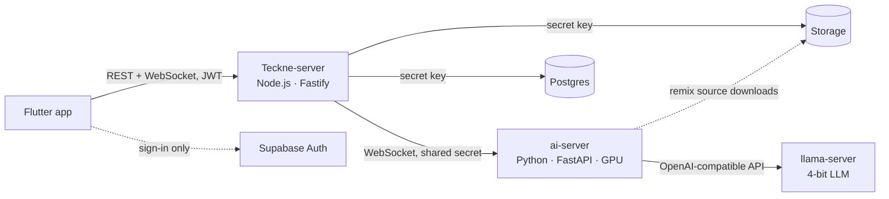
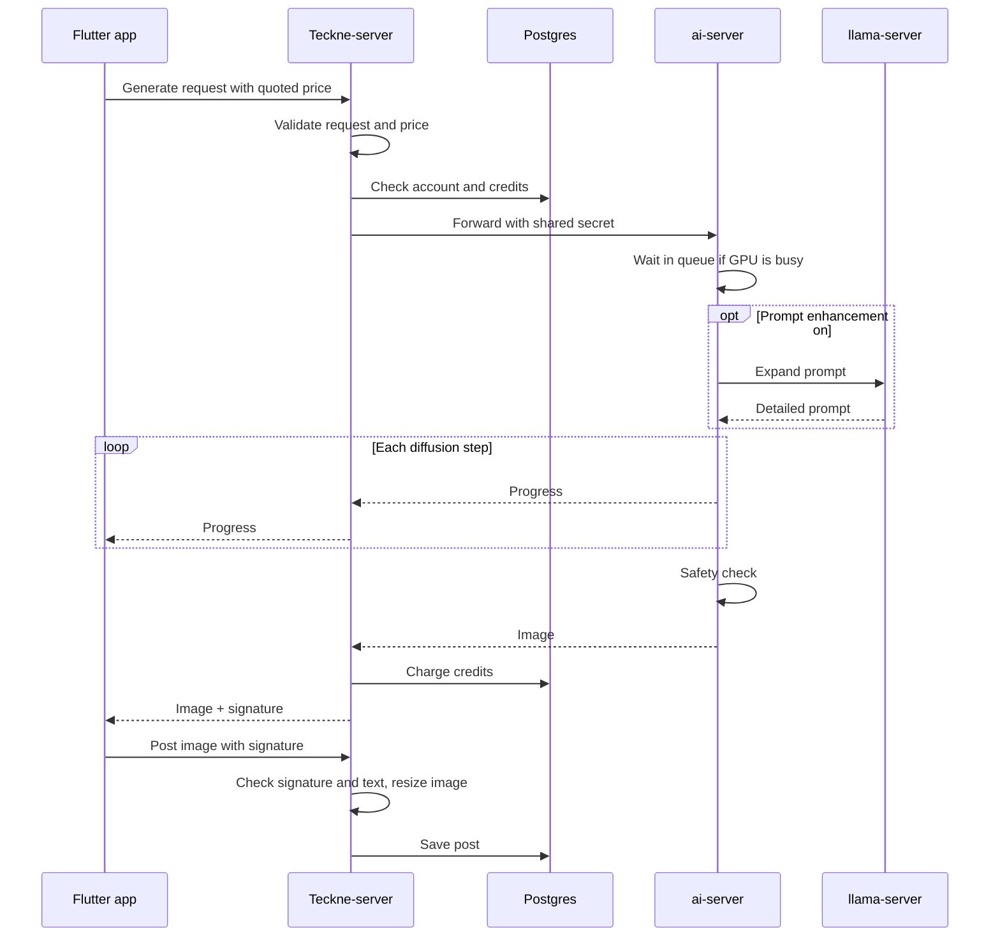

# Teckne

An AI image generation and social sharing app. Users generate images from text prompts, remix and caption them, and post them to a community feed. The image model and LLM run on a self-hosted GPU server.

I designed and built all three services myself: the Flutter app, the Node.js API, and the Python GPU server.

| | |
|---|---|
| **Services** | Flutter client, Node.js/Fastify API, Python/FastAPI GPU server, Supabase (Postgres, Storage, Auth) |
| **AI models** | FLUX 3 Image Klein, a 9B LLM running in llama.cpp, and image and text safety filters |
| **Status** | In-Development. |

---

## Features

- Generate images from a prompt and watch the progress live
- Get AI-suggested prompts and tags, or have the AI expand a short prompt into a detailed one
- Remix posted images with a new prompt or new size
- Add meme text and text boxes anywhere on the image
- Post to a feed you can filter by time, type, tags, and who you follow
- React, comment, follow, block, make collections, and save images privately
- Report posts, comments, and users. Moderators vote on reports.
- Pay for images with credits. Free accounts get a daily allowance.

---

## Architecture

The app only talks to Teckne-server. ai-server sits on a private network and only accepts connections from Teckne-server, which authenticates with a shared secret. Teckne-server is also the only thing that talks to the database and storage, so all the auth checks live there. It verifies the Supabase JWT on every request and checks ownership and moderator permissions before reading or writing anything. The app only uses Supabase to sign in.

### How an image gets made

## Technical Highlights

### Running the models on one GPU

- FLUX 3 Image Klein runs through Hugging Face `diffusers`. A 9B LLM (BFL's prompt upsampler, a Qwen3.5 fine-tune) runs next to it in `llama.cpp`.
- I converted the LLM to GGUF and quantized it to 4-bit. It's about 5x faster than running it in `transformers` and small enough to stay on the GPU with the image model. 6-bit gave slightly better results but was 25% slower and used 1.5 GB more VRAM.
- ai-server starts and stops llama-server itself and talks to it through its OpenAI-compatible API.
- On GPUs with less than 48 GB of VRAM, the text encoder and transformer take turns on the GPU, so it still runs on a 24 GB card.
- Each generation logs how long each stage took. Credit costs are set from those timings.

### LLM features

The same LLM does three things:

- Expands short prompts into the detailed descriptions FLUX works best with.
- Suggests prompt ideas. The server picks random words from lists (a subject, a setting, sometimes a twist) and has the model turn them into a creative image prompt.
- Suggests tags. The output is constrained with a JSON schema so it always comes back as exactly three valid tags.

### Queueing and cancellation

The GPU can only make one image at a time, and each image takes several seconds. While that's happening, the server still needs to send progress updates, accept new connections, and listen for cancel requests.

- Generation runs on a background thread (`run_in_executor`), so the main server loop stays free to handle WebSocket traffic. After each step, the background thread passes a progress update back to the main loop to send to the user.
- A lock (`asyncio.Lock`) lets one generation run at a time. Up to 10 more requests wait in line, and those users see that they're queued. Prompt suggestions don't use the image model, so they skip the line.
- Users can cancel partway through, so they don't wait or pay for an image they don't want, and the next person in line starts sooner. The diffusers pipeline has no built-in way to stop mid-run, so forward pre-hooks on the model check for a cancel and stop the run at the next step. Users can only cancel their own requests.

### Content safety and moderation

- Every generated image, and every image used as a remix source, goes through an image safety filter before anyone sees it. The FLUX license requires one.
- Only images that came from ai-server can be posted. When Teckne-server sends an image to the app, it signs it with an HMAC of the user ID and the image hash. The post endpoint rejects uploads without a valid signature, so you can't post an arbitrary file by calling the API directly.
- All user text (titles, captions, tags, comments) goes through a text safety filter before it's saved. If the model isn't available, the write is blocked instead of skipped.
- Users can report posts, comments, and other users. Moderators vote without seeing each other's votes, and the item is removed once enough of them agree. Repeat offenders get longer bans each time.
- Users have to accept the terms and finish their profile before generating. Deleting an account deletes all of the user's content. JWTs are redacted from logs.

### API security

- REST requests are validated with Fastify JSON schemas. The WebSocket proxy rebuilds each message from allowed fields instead of passing along whatever the client sent.
- Remix images can only come from the project's storage bucket, the user's last generated image, or a saved image they own (through a short-lived signed URL). ai-server also refuses redirects and limits download size.
- Rate limits on every route, one WebSocket per user, per-user generation quotas, and a 30-second heartbeat that drops dead connections and cancels their GPU jobs. The account is rechecked on every generation, so a banned user's open connection stops working.
- Helmet, CORS, and an origin check on the WebSocket connection. Storage deletes use file paths from the database, not from the client.

### Credits

- One credit is roughly one second of GPU time. The price only depends on the request (size, steps, prompt enhancement, generate or remix), so it doesn't change with load.
- The app gets a price table from the server, shows the cost on the Generate button, and sends that price back with the request. If it doesn't match, the request is refused, so users are never charged more than they saw.
- Balances only exist in Postgres. Charges happen in database functions with row locks and get written to an append-only ledger. A unique key on each grant means a retried event can't add credits twice.
- The daily free allowance resets without a cron job. There's also a daily cap on all free usage combined, so making extra accounts doesn't get more free GPU time overall.

### Flutter client

- Feature-first structure with Riverpod 3. Repositories handle data, notifiers handle state, and widgets just display it.
- Routing is driven by one auth state enum hooked into GoRouter, so screens don't handle auth redirects themselves.
- Meme text is stored as data and drawn on top of the image instead of baked in. All sizes are relative to the image, so it looks the same on a thumbnail and at 4K. It only gets burned in when you download, and editing a caption doesn't need a new image.
- Uploaded images are saved in three sizes (320, 1280, and 2560 px), and the app loads the smallest one that fits.

---

## Tech Stack

| Layer | Technologies |
|---|---|
| Client | Flutter, Dart, Riverpod 3, GoRouter, Dio, Freezed, WebSockets |
| API | Node.js, Fastify 5, `ws`, `sharp`, TensorFlow.js, `supabase-js`, `jsonwebtoken` |
| Inference | Python, FastAPI, Uvicorn, asyncio, PyTorch (CUDA), Hugging Face `diffusers` and `transformers`, llama.cpp |
| Data | PostgreSQL (Supabase) with SQL migrations and PL/pgSQL functions, Supabase Storage, Supabase Auth (OAuth, PKCE) |
| Models | FLUX 3 Image Klein, BFL prompt upsampler (Qwen3.5-9B fine-tune, 4-bit GGUF), image and text safety filters |

---

## What's Next

- **Deploy:** containerize the three services, add CI, and run ai-server on a private GPU host.
- **Tests:** add automated tests, starting with the credit functions and the WebSocket proxy's input validation.
- **Recommendations from embeddings:** store image and caption embeddings in pgvector and rank the feed by similarity to the tags and posts each user engages with.
- **Payments:** Stripe credit purchases.
- **New post types:** Video generation.
